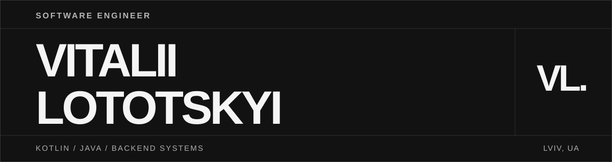

  

  <strong>Software Engineer</strong> · Kotlin / Java · Lviv, Ukraine

  <a href="https://portfolio.knalis.rest/">Portfolio</a> &nbsp;·&nbsp;
  <a href="https://www.linkedin.com/in/vitalii-lototskyi-20aa25374/">LinkedIn</a> &nbsp;·&nbsp;
  <a href="mailto:vitallot21@gmail.com">Email</a> &nbsp;·&nbsp;
  <a href="https://portfolio.knalis.rest/en/resume/">Résumé</a>

---

Backend-focused software engineering spanning distributed services, network protocols and product interfaces. Work includes independently developed applications with active users, open-source tools and full-stack systems.

## Selected projects

### 01 — [Mnemos](https://portfolio.knalis.rest/en/work/mnemos/)

**Realtime event platform** · Approximately 150 users · Paid features

A multi-service platform for live Cristalix/SAO events, player presence, subscriptions, notifications, profiles and account features. Kotlin and Spring Boot services exchange events through Kafka, with outbox/inbox processing, authenticated WebSocket connections and a React/TypeScript frontend.

[Case study](https://portfolio.knalis.rest/en/work/mnemos/)

### 02 — [WaveCode](https://portfolio.knalis.rest/en/work/wavecode/)

**Open optical-code format and cross-platform SDK**

A Rust library that encodes supported media links and optional timestamps into compact optical marks. The format includes error correction and needs no hosted track-ID database. A separate mobile-first web application provides camera scanning, code generation and SVG/PNG export.

[Case study](https://portfolio.knalis.rest/en/work/wavecode/) · [Try the scanner](https://wavecode.knalis.rest/) · [Rust library](https://github.com/knliiss/WaveCode) · [Web app source](https://github.com/knliiss/WaveCode-Web)

### 03 — [C7xBotManager](https://portfolio.knalis.rest/en/work/c7xbotmanager/)

**Headless multi-session automation** · Up to 500 concurrent clients · Approximately 10 paying users

A Java-based network runtime and native Go desktop manager for independent client sessions, protocol handling, proxy pools and automated recovery. Built for operating many accounts without starting a full game client for each session.

[Case study](https://portfolio.knalis.rest/en/work/c7xbotmanager/)

### 04 — [Studium](https://portfolio.knalis.rest/en/work/studium/)

**Full-stack learning management system** · Academic project

A role-based platform covering assignments, submissions, tests, grades, schedules and file management. Java/Spring services sit behind an API gateway, with a React/TypeScript interface and PostgreSQL, Kafka, Redis and MinIO. Developed and tested in a non-production environment.

[Case study](https://portfolio.knalis.rest/en/work/studium/) · [Repository](https://github.com/knliiss/Studium)

---

## Engineering focus

**Backend** &nbsp; Kotlin · Java · Spring Boot · Netty · REST APIs

**Systems & data** &nbsp; Kafka · PostgreSQL · Redis · WebSocket · Keycloak · Docker

**Product development** &nbsp; TypeScript · React · Rust · Go

## Recognition

**2026** · 1st place, Innovative Design — BEST Engineering Competition, BEST Lviv. Airlogix *Most Creative Approach* award.

**2025** · 2nd place, Team Design — BEST Engineering Competition, BEST Lviv.

## Education

**Lviv Polytechnic National University** · Software Engineering · 3rd year

---

  <a href="https://portfolio.knalis.rest/"><strong>View portfolio and engineering case studies</strong></a>

